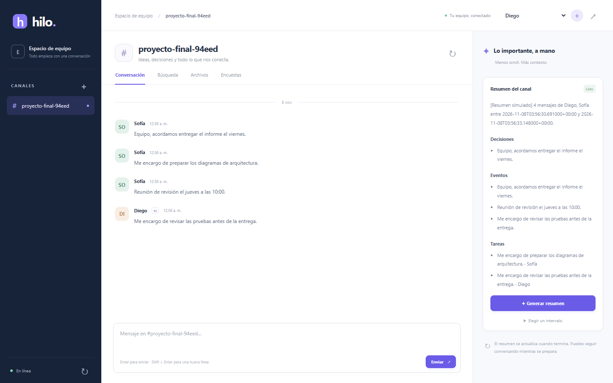

# Hilo · Chat con resúmenes

Interfaz web y API Gateway para el chat del curso: conversación, resúmenes, búsqueda, archivos, enlaces y encuestas. La web consulta y modifica datos **solo a través del gateway**. Cada microservicio conserva sus datos y eventos; resúmenes nunca accede a las bases del chat.



## Cómo correrlo

Necesitas Docker Compose. Para levantar también los servicios de los otros equipos, necesitas Python 3 y Git al preparar sus fuentes.

1. Crea `.env` en la raíz, sin subirlo a Git:

   ```env
   LLM_API_KEY=tu_key_de_gemini
   POLLS_DB_PASSWORD=elige_una_clave_larga
   ```

2. Prepara las versiones de los equipos y levanta el entorno completo:

   ```bash
   python tools/prepare_peers.py
   docker compose -f docker-compose.yaml -f compose.peers.yaml up -d --build --wait
   ```

3. Abre **http://localhost:8080**. Crea un usuario y un canal para comenzar. Puedes cambiar de usuario desde la barra superior para probar los votos.

Las fuentes externas quedan en `.peers/`, ignoradas por Git y sin cambios en su código. El Compose crea la red **`microsvcs`**. Los servicios de los equipos no publican puertos al host, evitando sus conflictos habituales en `8004` y `8080`.

Para apagar conservando los datos:

```bash
docker compose -f docker-compose.yaml -f compose.peers.yaml down
```

### Si los servicios del equipo ya están corriendo

Conéctalos a `microsvcs`, configura sus URLs en `.env` y ejecuta `docker compose up -d --build --wait` sin `compose.peers.yaml`. Las URLs internas por defecto son:

| Variable | Servicio |
| --- | --- |
| `USERS_URL`, `CHANNELS_URL`, `MESSAGES_URL` | `http://users:8000`, `http://channels:8000`, `http://messages:8000` |
| `SUMMARIES_URL` | `http://summaries:8000` |
| `MEDIA_URL` | `http://media:8000` |
| `SEARCH_URL` | `http://search:8000` |
| `POLLS_URL` | `http://polls-api:8004` |

Sin `/api/v1` al final. Para servicios publicados en el host usa `http://host.docker.internal:PUERTO`. `GATEWAY_PORT` y `SUMMARIES_PORT` permiten cambiar los puertos host si están ocupados. El exchange `chat` debe tener la misma durabilidad en todos los consumidores: `CHAT_EXCHANGE_DURABLE=true` para los equipos actuales y `false` para el demo original.

## Usar y conectar otros equipos

- Web: **http://localhost:8080**.
- Explorador GraphQL: http://localhost:8080/api/v1/graphql.
- API REST de resúmenes: http://localhost:8004/docs.
- Dentro de Docker: `http://summaries-gateway:8000/api/v1/graphql` o `http://summaries:8000/api/v1`.

Un resumen se solicita con `requestSummary`; devuelve un ID sin esperar al LLM. La web consulta hasta `completada` o `fallida`. Se puede elegir un intervalo `[start, end)` o resumir solo los mensajes nuevos.

Las encuestas se descubren por sus anuncios del chat y se recuerdan en el navegador; también puedes abrirlas por ID. La búsqueda tiene consistencia eventual y puede tardar unos segundos en mostrar mensajes nuevos. Archivos permite subir, descargar y eliminar los propios; los enlaces compartidos muestran su preview cuando Media termina de procesarlos.

El chat usa identidad declarada, sin autenticación: seleccionar un usuario no equivale a iniciar sesión. El demo original del profesor tiene un fallo en sus POST; el entorno integrado usa el núcleo corregido del equipo de búsqueda. Las direcciones y contratos revisados están en [la guía del gateway](gateway/README.md).

## Resumen automático

El servicio conserva el disparo por `chat.channel.entered`, producido por un componente externo. La interfaz genera resúmenes bajo demanda. Para probar el evento manualmente:

```bash
docker compose exec summaries python -m app.tools.publish_channel_entered CHANNEL_ID USER_ID ENTRY_ID
```

## Pruebas y demostración

```bash
docker compose -p summaries-tests -f compose.test.yaml up --build --abort-on-container-exit --exit-code-from tests --attach tests
docker compose -p summaries-tests -f compose.test.yaml down -v
```

**291 pruebas aprobadas**: servicio, gateway, contratos, fallas parciales, búsqueda, encuestas, archivos y eventos compatibles. Las pruebas simulan Gemini y las APIs externas; no gastan cuota.

Video: [demostración de la interfaz](docs/evidencia/demo-interfaz.mp4). La grabación usa las APIs reales de los equipos en un entorno descartable y Gemini simulado. Pasos y límites de la verificación: [INTERFAZ.md](docs/INTERFAZ.md).

Documentación del servicio: [referencia técnica](docs/REFERENCIA.md), [despliegue Kubernetes](docs/DESPLIEGUE.md) y [esquemas de eventos](docs/eventos/).
