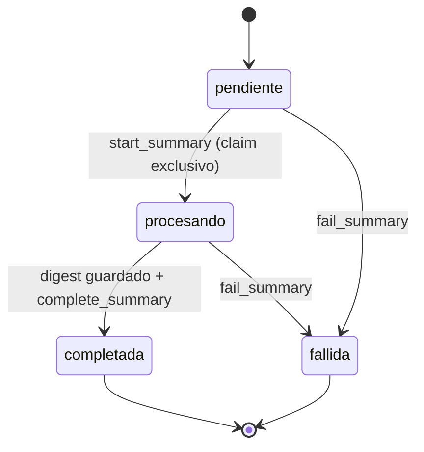

# Referencia técnica del proyecto

Documento global para conceptos, contratos y detalles de implementación. Las decisiones de arquitectura y el siguiente paso quedan en `CLAUDE.md`; ejecución y estado, en `README.md`.

## Glosario

| Término | Significado en este proyecto |
| --- | --- |
| LLM | Modelo de IA al que se envía una conversación para resumirla. |
| Polling | Consultar periódicamente el GET de un resumen hasta que termine. |
| Lifespan | Inicio y cierre de recursos de FastAPI. |
| Pool de conexiones | Conexiones abiertas que se reutilizan para varias llamadas. |
| Threadpool | Hilos para ejecutar llamadas síncronas sin bloquear el servidor async. |
| Timeout | Tiempo máximo de espera por conexión, lectura, escritura o acceso al pool. |
| Idempotencia / replay | Repetir una operación o evento sin duplicar su efecto. |
| Claim / compare-and-set | Cambio condicional de pendiente a procesando que concede el trabajo a un solo worker. |
| Worker | Consumidor que ejecutará la generación fuera de la petición HTTP. |
| Cursor | Par fecha/ID que indica hasta dónde se recorrieron o resumieron mensajes. |
| Ventana semiabierta | Intervalo `[start,end)`: incluye start y excluye end. |
| UTC / BSON Date | Zona horaria común y formato de fecha de Mongo, con precisión de milisegundos. |
| UUID / ObjectId | UUID es el ID público; ObjectId es el `_id` interno de Mongo. |
| Proyección local | Copia de mensajes reconstruible; el núcleo sigue siendo su fuente de verdad. |
| Atomicidad | Una escritura se aplica completa o no se aplica; aquí se garantiza por documento. |
| Exchange / routing key / cola | RabbitMQ enruta eventos de un exchange a colas según su tipo. |
| Durable / persistente | Durable conserva la definición del exchange/cola; persistente conserva un mensaje si se configura su entrega. |
| Ack / requeue | Confirmar un mensaje consumido o devolverlo a la cola. |
| Outbox / inbox | Evento pendiente de publicación / trabajo recibido y guardado. Implementados para summary.requested y para los eventos terminales (summary.generated / summary.failed). |
| Snapshot / cobertura | IDs e intervalo fijados para una solicitud / marca de qué mensajes ya se confirmaron en un incremental. |
| Dead letter | Mensaje rechazado que pasa a una cola de errores para inspección, sin reintento infinito. |
| Lease / ownership | Permiso temporal de un worker para recuperar trabajo sin competir con uno anterior; aún pendiente. |
| MockTransport | Transporte de HTTPX que simula respuestas o fallas en pruebas sin contactar al núcleo. |

## Persistencia — etapa 2

Contrato interno implementado en app/models.py y app/repository.py, integrado con REST por app/services.py. Base propia configurable con MONGODB_DATABASE=summaries, alojada en summaries-mongodb; su colección messages es una proyección reconstruible, no la fuente de verdad del chat.

## Modelos y colecciones

| Colección / modelo | Campos relevantes | Invariantes |
| --- | --- | --- |
| `summaries` / `Summary` | id, channel_id, requested_by, messageState, timeInterval opcional, content, error, created_at, updated_at | UUID4 nuevo; content solo en completada, error solo en fallida; updated_at >= created_at |
| `digests` / `Digest` | id, summary_id, channel_id, timeInterval efectiva, content, message_count, first_message_id, last_message_id, last_message_at, created_at | Resultado inmutable, 1:1 con summary, al menos un mensaje, último mensaje dentro de la ventana; mismo canal e intervalo solicitado |
| `checkpoints` / `Checkpoint` | channel_id, last_message_id, last_message_at, last_summary_id | Un documento por canal; cursor temporal monotónico y ligado a un resumen incremental completado |
| `messages` / `LocalMessage` | id, channel_id, author_id, content, created_at | Mismos campos públicos del núcleo; ID único, contenido de 1 a 4000 caracteres; replay idéntico no modifica datos |

Desde el paso 4, Checkpoint.messages_since cuenta mensajes locales **sin cobertura incremental**, incluyendo tardíos anteriores al cursor. El cursor sigue siendo `(last_message_at, last_message_id)` y nunca retrocede; no representa una lectura por usuario ni certifica que hayan llegado todos los eventos del núcleo. Sin resúmenes incrementales confirmados se cuenta todo el historial local.

Metadatos internos: summaries._request_delivery contiene evento/published/received; summaries._window contiene IDs/intervalo del snapshot; messages._history.covered registra cobertura. No aparecen en los modelos ni en las respuestas HTTP. Documentos anteriores sin _history conservan el filtro temporal del checkpoint; cuando solo existe un digest legado, se confirman conservadoramente sus extremos conocidos. El resto permanece pendiente de cobertura.

Modelos Pydantic v2 congelados, campos desconocidos rechazados, IDs no vacíos. Las fechas requieren zona y se normalizan a UTC con precisión de milisegundos (BSON). Este redondeo se aplica también a los límites solicitados; ventanas que colapsan al mismo milisegundo se rechazan. Los modelos usan `id` string; el `_id` interno nunca aparece en su JSON. Datetimes se escriben como BSON Date y se leen con `tz_aware=True`.

Los IDs de entidades del núcleo solo son referencias: este repositorio no comprueba canales/autores con bases externas. El servicio de aplicación deberá validarlos por API.

## Índices inicializados al arrancar

| Colección | Índices además de `_id_` |
| --- | --- |
| summaries | id único; (channel_id, created_at DESC, id DESC); (channel_id, messageState, created_at DESC, id DESC); (messageState, updated_at); (_request_delivery.published, created_at); (_request_delivery.received, messageState) |
| digests | id único; summary_id único; (channel_id, created_at DESC, id DESC) |
| checkpoints | channel_id único |
| messages | id único; (channel_id, created_at ASC, id ASC); (channel_id, _history.covered, created_at ASC, id ASC) |

`ensure_indexes()` se puede repetir. Si hay datos duplicados o un índice incompatible, el inicio falla: no borra ni corrige datos silenciosamente. No hay TTL, migración destructiva ni modificación del núcleo.

## Operaciones del repositorio

| Método | Resultado y comportamiento |
| --- | --- |
| create_summary(channel_id, request=None, event_factory=None) | Crea pendiente y UUID4; con event_factory guarda también requested en la misma escritura; no llama al broker ni al LLM |
| get_summary(id) | Summary o SummaryNotFound (404) |
| list_summaries(channel_id, limit=100, offset=0) | Todas las solicitudes del canal, nuevas primero; limit positivo y offset no negativo |
| latest_summary(channel_id) | Completado más reciente por fecha de solicitud e ID; 404 si no existe ninguno |
| start_summary(id) | Claim atómico de pendiente a procesando; segundo worker recibe 409 |
| save_digest(digest) | Valida relación y, si existe snapshot, conteo/IDs/intervalo/cursor; un resultado nuevo requiere procesando. Repetir el mismo resultado devuelve el original; distinto recibe 409 |
| get_digest(id) / get_digest_for_summary(id) | Digest o None |
| complete_summary(id) | Requiere digest persistido; copia su content y confirma procesando → completada |
| fail_summary(id, error) | Pendiente/procesando → fallida; exige error con texto |
| upsert_message(message) | True si se insertó, False si es replay idéntico; mismo ID con payload diferente recibe 409 y conserva el original |
| get_message(id) | LocalMessage o None |
| list_messages(channel_id, time_interval=None, after=None, limit=1000) | Ventana semiabierta `[start,end)`, orden cronológico estable; `after` es un Checkpoint del mismo canal para continuar páginas |
| count_messages(channel_id, time_interval=None, after=None) | Mismos filtros que list_messages, sin límite de página |
| get_checkpoint(channel_id) | Cursor y conteo de cobertura pendiente; si no existe, modelo inicial sin crear documento |
| advance_checkpoint(summary_id) | Requiere completado incremental/digest; marca únicamente los IDs del snapshot y avanza el cursor solo si es mayor. Repetible tras reinicios |
| list_pending_messages(channel_id, before, after=None, limit=1000) | Pendientes, incluidos tardíos, anteriores al corte fijo; after continúa la página por fecha/ID |
| get_window(id) / save_window(id, message_ids, interval) | Lee/guarda el snapshot inmutable. El primer guardado gana; un retry recibe el original |
| pending_request_events() / mark_request_published(id) | Outbox de requested y confirmación tras publicar al broker |
| receive_summary_request(event) / received_requests() | Valida contra la solicitud local y registra/consulta la bandeja durable; no cambia pendiente a procesando |

Las confirmaciones terminales con el mismo resultado/error son idempotentes; una confirmación diferente recibe `SummaryStateConflict` (409). No hay una operación genérica `save(summary)` que permita saltarse estados ni actualizar resultados inmutables. Las colecciones son accesibles para infraestructura/pruebas, pero la lógica de aplicación debe usar estos métodos.



## Integración en las siguientes etapas

FastAPI expone el repositorio como `app.state.repository`. Para rutas síncronas usar `RepositoryDependency` (o `Depends(get_repository)`). PyMongo es bloqueante: desde consumidores o endpoints async ejecutar las operaciones en threadpool, nunca bloquear el event loop. El lifespan ya inicializa ping/índices de esta forma y cierra Mongo incluso si hay un error.

Ejemplo de bajo nivel (sin outbox ni worker; solo muestra la persistencia con contenido simulado):

```python
from datetime import timedelta
from app.models import Digest, LocalMessage, TimeInterval, utc_now

repository = app.state.repository
now = utc_now()
message = LocalMessage(id="message-id", channel_id="channel-id", author_id="user-id",
                       content="Decidimos entregar el viernes.", created_at=now)
repository.upsert_message(message)
summary = repository.create_summary(message.channel_id)
repository.start_summary(summary.id)
repository.save_digest(Digest(
    summary_id=summary.id, channel_id=message.channel_id,
    timeInterval=TimeInterval(start=now, end=now + timedelta(milliseconds=1)),
    content="Se acordó entregar el viernes.", message_count=1,
    first_message_id=message.id, last_message_id=message.id, last_message_at=now,
))
repository.complete_summary(summary.id)
checkpoint = repository.advance_checkpoint(summary.id)
assert checkpoint.messages_since == 0
```

SummaryService.build_window ya reconstruye el historial por API y recorre todas las páginas locales. Guarda IDs e intervalo en _window antes de devolverlo; un reintento rehidrata ese snapshot sin cambiar sus entradas. El futuro worker debe enviar esos mensajes al LLM y construir el digest correspondiente; el repositorio comprueba sus metadatos contra el snapshot, no puede comprobar lo que recibió un proveedor externo. El default de 1000 es tamaño de página, nunca un truncamiento del historial.

Con un `timeInterval` solicitado, el resultado solo cubre ese intervalo y `advance_checkpoint` lo rechaza; no debe consumir el progreso incremental del canal. Sin intervalo, el avance sigue siendo explícito y no ocurre solo por completar el resumen. Una ventana vacía no genera digest: el futuro worker deberá confirmar `fallida` con un error explicativo sin llamar al LLM.

## Concurrencia, fallas y límites deliberados

- El historial soporta entrega al menos una vez; un payload incompatible para el mismo ID no se sobreescribe. RabbitMQ confirma con ack después de persistir; conflictos de payload van a la cola de errores.
- Cursores ordenados por `(created_at, id)` con comparación estricta. Si llegan mensajes posteriores mientras corre el LLM, al avanzar el checkpoint siguen contándose; no se hace un reset ciego del contador. El valor de `messages_since` es una vista eventual, no un snapshot atómico entre colecciones.
- Política elegida por el usuario: un histórico tardío sin cobertura cuenta como pendiente y entra en el próximo incremental; no se reescriben summaries/digests publicados. Si llega después de fijar un snapshot, permanece pendiente aunque se confirme ese snapshot. Un incremental que solo cubre tardíos puede confirmar cobertura sin mover el máximo del cursor.
- Guardar digest, completar summary y avanzar checkpoint son operaciones separadas. Mongo standalone no ofrece una transacción global aquí. Si cae el proceso tras guardar digest, se puede recuperar el resultado y confirmar sin otra llamada al LLM; si cae tras completar, se repite el avance. Si falla el resumen mientras otro hilo guardaba digest, puede quedar ese resultado interno; nunca convierte la falla en éxito. El worker del paso 7 deberá implementar recuperación de trabajos en procesando y evitar workers obsoletos mediante lease/ownership antes de permitir reclamos tras caídas.
- Una ventana incremental selecciona mensajes sin cobertura, no todos los que caen dentro de su intervalo envolvente. La solicitud explícita por intervalo sí incluye todo el historial de ese rango. El snapshot identifica el conjunto exacto; no inferir cobertura a partir de un máximo arbitrario ni marcar mensajes que llegaron después.
- Requested usa outbox/inbox embebidos: hay atomicidad de solicitud+evento en Mongo y entrega al menos una vez al broker. No existe una transacción distribuida Mongo–RabbitMQ; el ack perdido puede repetir un evento. Generated/failed siguen pendientes del paso 8. GET /events continúa como espejo en memoria.
- Un error de PyMongo durante una futura petición se responde 503 con `{"detail":"Summary storage unavailable"}`; fallas de arranque impiden que la app sirva. Los errores de estado/payload persistente son 409, y la solicitud de un summary inexistente es 404.

## Verificación

La suite de `tests/` ejecuta operaciones e índices sobre MongoDB 7 real y fuerza concurrencia con ocho hilos: un solo claim, un solo mensaje/digest por ID y checkpoint final máximo. También cubre la carrera éxito/falla, replays, aislamiento de canales, límites de ventana, empates de fecha, persistencia al abrir otra conexión, validación y arranque fallido con cierre del cliente. Las instrucciones reproducibles están en README.

Además, en el Compose de desarrollo se guardó un summary completado con su digest, mensaje y checkpoint en una base temporal; se recrearon los contenedores Mongo/FastAPI, se releyeron las cuatro colecciones y se repitió el avance idempotente. Los datos y los índices sobrevivieron usando el volumen propio. La base temporal se eliminó al finalizar y `/health`/OpenAPI continuaron disponibles en 8004.

## Hallazgos del código base del curso (`microservicios/03_Comunicación/demo`)

Verificado leyendo el código; tener en cuenta antes de implementar.

### Broker y eventos
- **El broker es RabbitMQ** (patrón visto en `04_Implementación/demo_04`, con `pika`; imagen `rabbitmq:4-management-alpine`, puertos 5672 y UI 15672, red externa `microsvcs`).
- **El compose del demo 03 NO levanta RabbitMQ.** Hay que agregarlo (o levantar el de `demo_04/message_broker`) y el host será el nombre del servicio en la red `microsvcs`.
- El compose original del curso no define RABBITMQ_URL. En el entorno actual ya se aplicó un override por stdin para que messages use amqp://summaries-rabbitmq:5672; repetirlo si se recrea desde el compose original. Comando en README, sin editar archivos del núcleo.
- `messages` publica en el exchange **`chat`**, tipo `topic`, declarado **no durable** (`exchange_declare(exchange="chat", exchange_type="topic")`). Si el servicio declara el exchange con `durable=True` RabbitMQ fallará con `PRECONDITION_FAILED`: declararlo con los mismos parámetros (no durable) o usar `passive=True`. Los mensajes se publican sin `delivery_mode` persistente.
- `routing_key` = tipo del evento (`chat.message.created`). `users` y `channels` **no publican al broker**, solo guardan en una lista en memoria (`GET /api/v1/events`); sus eventos son `chat.user.created` y `chat.channel.created`.
- Si el broker está caído, `messages` ignora el error silenciosamente (sin outbox): puede haber mensajes que nunca lleguen como evento → por eso se reconstruye con `GET .../messages`.
- Formato del evento (JSON):
  ```json
  {"type": "chat.message.created", "subject_id": "<id>", "occurred_at": "<ISO8601 UTC>", "data": {...}}
  ```
  Usar el mismo formato (`type`, `subject_id`, `occurred_at`, `data`) para `summary.*`. Los eventos del servicio deben publicarse en su propio exchange (p. ej. `summaries`, topic, durable) y exponer también `GET /api/v1/events` por consistencia con el curso.
- Patrón de consumo del demo_04: cola durable propia por servicio (`<servicio>_for_<x>_queue`), `queue_bind` con routing key, `basic_ack` manual. Usar una cola propia para `chat.message.created` (si no, se compite con otros consumidores).
- `pika.BlockingConnection` es bloqueante: en FastAPI correrlo en un hilo/proceso aparte (o usar `aio-pika` en el `lifespan`).

### Contratos del núcleo
- Puertos locales: users 8001, channels 8002, messages 8003; **dentro de la red `microsvcs` todos escuchan en 8000** → `http://users:8000`, `http://channels:8000`, `http://messages:8000`.
- IDs son `uuid4` en string (campo `id`, no `_id`).
- `GET /api/v1/users/{id}` → `{id, display_name}`; 404 `{"detail": "User not found"}`.
- `GET /api/v1/channels/{id}` → `{id, name}`; 404 `{"detail": "Channel not found"}`.
- Mensaje: `{id, channel_id, author_id, content, created_at}` (`created_at` ISO8601 UTC, `content` hasta 4000 caracteres). Sin campo de hilo/estado.
- `GET /api/v1/channels/{id}/messages` devuelve **lista completa sin paginación, sin filtro por fecha y sin garantía de orden** (orden de inserción de Mongo): filtrar por `created_at` y ordenar en el servicio. Ojo con canales grandes.
- Los servicios responden con errores `{"detail": "..."}` (FastAPI estándar); el POST de `messages` usa 404 canal inexistente, 422 autor inexistente, 502/503 dependencias caídas, y timeout de 2 s hacia otros servicios (usar un timeout similar).
- No hay autenticación en ningún servicio ni Gateway en el demo 03 (el Gateway del curso aparece en las unidades 4–5, GraphQL, `demo_04/api-gateway`). Por tanto, `summary.requested` probablemente lo debe publicar el propio servicio.
- Eventos de usuarios/canales no llevan el nombre del autor en el mensaje: para el prompt del LLM resolver `author_id` → `display_name` vía `GET /users/{id}` (con caché).

### Convenciones del stack del curso
- Python 3.12-slim, `fastapi==0.115.12`, `uvicorn[standard]==0.34.2`, `pymongo==4.12.1`, `pika==1.3.2`; Mongo `mongo:7` con volumen propio. Dockerfile: `COPY app ./app` + `uvicorn app.main:app --host 0.0.0.0 --port 8000`.
- Base de datos del servicio con su propio contenedor (`summaries-mongodb`) y volumen (`summaries-data`).
- Red: `networks: microsvcs: name: microsvcs` (en compose propio usar `external: true`; el demo 03 la crea, hay que levantarlo primero).
- Todas las rutas bajo `/api/v1`, más `GET /health` → `{"status": "ok"}`.
- Cada transacción emite evento; el patrón del demo es una función `publish(event_type, subject_id, data)` que guarda en la lista local `events` y publica al broker.

### Pendiente por definir (no está en el repo del curso)
- URL, autenticación y formato de `<LLM_API>/generate` (no existe en el código revisado).
- Si habrá un Gateway real que publique `summary.requested`; mientras tanto, publicarlo y consumirlo desde este mismo servicio.


## Cliente HTTP del núcleo — etapa 3

OpenAPI verificado en `localhost:8001/8002/8003/openapi.json`. Las respuestas no declaran schemas de salida; los campos se contrastaron con el código de los contenedores del curso, sin acceder a sus bases de datos.

| Método de CoreClient | API consumida | Resultado |
| --- | --- | --- |
| get_channel(id) | GET CHANNELS_URL/api/v1/channels/{id} | dict con id y name |
| get_user(id) | GET USERS_URL/api/v1/users/{id} | dict con id y display_name |
| list_messages(channel_id) | GET MESSAGES_URL/api/v1/channels/{id}/messages | Lista completa de dicts con id, channel_id, author_id, content, created_at |

**Corrección al hallazgo inicial:** GET de mensajes devuelve `[]` incluso para un canal inexistente. El 404 de canal pertenece al POST. La orquestación debe llamar a get_channel cuando necesite validar existencia; list_messages no hace otra petición implícita.

| Respuesta/falla del núcleo | Error del servicio |
| --- | --- |
| 404 de users | UserNotFound, 422 |
| 404 de channels o messages | ChannelNotFound, 404 |
| Timeout, error de red/proxy, HTTP 429/503/504 | DependencyUnavailable, 503 |
| Otro estado HTTP, protocolo inválido o cuerpo inválido | DependencyFailed, 502 |

Se exige HTTP 200 y JSON válido. Usuarios/canales deben tener el ID solicitado; cada mensaje debe pertenecer al canal consultado. Nombres de 1 a 80 caracteres, contenido de mensaje de 1 a 4000 y fechas ISO8601 con zona. Los campos adicionales se ignoran; los campos conocidos se validan completos antes de devolver resultados. Una lista con un registro inválido se rechaza completa.

Los resultados mantienen dict/list[dict]. Las fechas de mensajes se devuelven como strings UTC con precisión de milisegundos, compatibles con LocalMessage y el repositorio. Se conserva el orden del núcleo: filtrado, orden y reconstrucción corresponden al paso 4. No se trunca la lista, no se cachea ni se reintenta automáticamente.

`app.state.core_client` reutiliza un httpx.Client durante el lifespan. Las rutas síncronas lo reciben con `CoreClientDependency`; los consumidores async deben usar threadpool. Para uso puntual, `with CoreClient() as core:` o las funciones originales get_channel/get_user/list_messages, que abren y cierran su cliente por llamada.

`CORE_TIMEOUT_SECONDS` debe ser positivo y finito; por defecto 2 segundos para conexión, lectura, escritura y pool (no un plazo total de toda la respuesta). Las URLs admiten HTTP(S), sin query ni fragmento; los IDs se codifican como segmentos. No se siguen redirecciones ni proxies del entorno. Las fallas usan mensajes propios, sin reenviar cuerpos ni detalles de conexión del núcleo. Crear el cliente no contacta al núcleo: su caída no impide arrancar este servicio.

Las pruebas HTTP usan MockTransport dentro de `tests/test_app.py`; las de persistencia siguen usando MongoDB 7 real. Se verifica también la inyección en FastAPI y el cierre del pool al apagar. Referencias: [cliente HTTPX](https://www.python-httpx.org/advanced/clients/), [timeouts](https://www.python-httpx.org/advanced/timeouts/) y [errores](https://www.python-httpx.org/exceptions/).

## Ventanas — paso 4

`SummaryService.build_window(summary_id)` se ejecutará en el worker, nunca durante POST. En el primer armado valida canal, obtiene la lista completa por la API de messages e inserta lo faltante con el mismo upsert del consumidor RabbitMQ. Una falla de la API se propaga: no se entrega silenciosamente un historial local parcial. No se borran mensajes locales porque no aparezcan en una respuesta remota.

- Con timeInterval solicitado: seleccionar todos los mensajes del canal en `[start,end)`, incluso los ya cubiertos por un incremental.
- Sin timeInterval: seleccionar solo mensajes sin cobertura y con created_at estrictamente anterior al created_at de la solicitud. Esto fija el corte temporal; los mensajes posteriores quedan para otra solicitud. Los tardíos anteriores al checkpoint también se seleccionan.
- Leer páginas por `(created_at ASC,id ASC)` hasta agotarlas. Un empate de fecha se resuelve por ID; el tamaño de página no limita la cantidad total.
- Guardar `_window = {message_ids, timeInterval}` una sola vez mediante una actualización condicional. Su intervalo efectivo envuelve los mensajes seleccionados; los IDs son el conjunto exacto, que puede tener huecos en incrementales. En un reintento se lee el snapshot guardado, no una conversación diferente.
- Una ventana vacía devuelve mensajes vacíos y, si no había rango solicitado, intervalo None. No cambia el estado ni crea un digest; el worker del paso 7 deberá confirmar fallida sin invocar al LLM.

Al confirmar un incremental se marcan covered únicamente los IDs del snapshot. Luego se actualiza el checkpoint si su cursor es mayor. Ambas operaciones son repetibles pero no una transacción multicolección; el worker debe recuperar una confirmación interrumpida. Los tardíos que lleguen entre el snapshot y la confirmación conservan covered=False. Si solo se resumen tardíos, la cobertura avanza aunque el máximo temporal del checkpoint permanezca igual.

Los snapshots y resultados están sujetos al límite de documento de MongoDB y el proveedor a su contexto de tokens. El paso 7 debe resolver conversaciones grandes mediante partes/progreso persistido, manteniendo un resultado final por solicitud y sin truncar entradas silenciosamente.

## REST y solicitudes durables — pasos 5–6

| Ruta | Comportamiento |
| --- | --- |
| POST /api/v1/channels/{id}/summaries | Valida canal/usuario, guarda pendiente y requested, responde 202 + summary_id/messageState y Location |
| GET /api/v1/summaries/{id} | Solo Mongo: 200 con pendiente/procesando/completada/fallida, o 404 |
| GET /api/v1/channels/{id}/summaries | Valida canal y lista por fecha/ID descendentes; limit 1–1000 (default 100), offset ≥ 0 |
| GET /api/v1/channels/{id}/summaries/latest | Valida canal y devuelve el completado de solicitud más reciente; 404 si no hay |

POST no llama al historial ni al LLM y no espera la publicación AMQP. Sí espera las validaciones HTTP y la confirmación Mongo. El evento se guarda con el summary en una sola inserción; si RabbitMQ cae, se conserva para publicar cuando vuelva. Una caída de Mongo impide aceptar la petición y responde 503. Un canal/usuario inválido no genera ni solicitud ni evento.

Ejemplo del evento real de solicitud:

```json
{
  "type": "summary.requested",
  "subject_id": "summary-uuid",
  "occurred_at": "2026-10-18T15:00:00+00:00",
  "data": {"channel_id": "channel-uuid", "requested_by": "user-uuid", "timeInterval": null}
}
```

La inserción deja published=False/received=False. El publicador envía con confirmación y marca published=True; si cae entre ambas operaciones se repite el evento. El consumidor comprueba subject/data contra la solicitud persistida y marca received=True antes del ack. `received_requests()` es la bandeja durable del futuro worker: un mensaje consumido no se pierde por no haberlo procesado todavía y permanece pendiente. Un evento externo no puede crear una solicitud ni cambiar sus referencias.

Hasta completar el paso 7, no hay transición automática a procesando/completada/fallida. Los tests recorren estados terminales usando las operaciones reales del repositorio con contenido controlado; eso no es un LLM de producción.

## Topología y operación RabbitMQ — paso 6

| Exchange | Tipo / durable | Uso |
| --- | --- | --- |
| chat | topic / false | Compatible con el publicador del curso |
| summaries | topic / true | summary.requested, summary.generated, summary.failed |
| summaries.deadletters | topic / true | Eventos rechazados por formato o conflicto |

| Cola propia, durable | Binding | Confirmación |
| --- | --- | --- |
| summaries_for_chat_messages_queue | chat / chat.message.created | Ack tras upsert local |
| summaries_for_summary_requested_queue | summaries / summary.requested | Ack tras registrar recepción en Mongo |
| summaries_errors_queue | summaries.deadletters / # | Inspección manual; sin consumidor que reintente automáticamente |

EventBroker mantiene una sola conexión/canal de pika.BlockingConnection en un hilo propio. Solo ese hilo llama a pika. Usa prefetch 20 y publica páginas de outbox entre ciclos de consumo; no ejecuta llamadas LLM. El lifespan detiene el hilo antes de cerrar HTTP/Mongo. La configuración del broker se valida antes de lanzar el hilo.

Los requested se publican con delivery_mode=2, mandatory=True, confirmaciones y message_id estable `summary.requested:<id>`. En cambio, el núcleo publica chat sin persistencia y puede perder eventos: de ahí la reconciliación por API. No se promete entrega exactamente una vez; los efectos se deduplican en Mongo.

Se valida envelope, routing key, subject y payload. JSON inválido, subject inconsistente, solicitud desconocida o mismo ID con contenido diferente se rechazan sin requeue y van a deadletters. Una falla Mongo hace nack/requeue con espera; una falla AMQP reinicia conexión/topología sin borrar la outbox. Prefetch y pausas limitan los reintentos durante una caída.

RabbitMQ usa volumen summaries-rabbitmq-data y hostname summaries-rabbitmq para mantener su identidad al recrear el contenedor; no expone puertos al host. El chat base y este servicio usan amqp://summaries-rabbitmq:5672. El override del README configura messages en ejecución; volver al compose original sin ese override elimina esa variable al recrearlo.

El helper `publish()` y el espejo en memoria se eliminaron: todos los eventos del servicio son durables (outbox en el documento del summary). `GET /api/v1/events?limit&offset` los lee de Mongo, más antiguos primero.

Referencias: [Pika 1.3.2, BlockingConnection](https://pika.readthedocs.io/en/1.3.2/modules/adapters/blocking.html) y [RabbitMQ dead-letter exchanges](https://www.rabbitmq.com/docs/dlx).

## Contratos propuestos para pasos pendientes

Estas interfaces orientan los pasos 7–9; **todavía no están implementadas**. El usuario eligió HTTP para LLM y eventos de Gateway para la entrada.

### LLM — paso 7 (mock y Gemini implementados)

`app/clients/llm_client.py` define el contrato interno `LLMRequest` (summary_id, channel_id, messages con `author_name`, prompt) → texto, tras la interfaz `LLMProvider`. `LLM_PROVIDER=mock` (default) devuelve un resumen determinista y permite simular fallos con `[mock:fail]` (definitivo) y `[mock:retry]` (transitorio) en el contenido de un mensaje. `LLM_PROVIDER=gemini` usa `GeminiProvider`: `POST {LLM_API_URL}/models/{modelo}:generateContent` con la credencial en la cabecera `x-goog-api-key` (nunca en la URL ni en errores), prompt como `systemInstruction`, transcripción `[fecha] autor: contenido` y temperatura 0.2; ignora las partes de razonamiento (`thought`). Ante 429 reintenta una vez si el proveedor pide esperar ≤ `LLM_RETRY_MAX_WAIT_SECONDS`; si persiste (o ante 5xx, timeout o error de red) prueba el modelo de respaldo `LLM_FALLBACK_MODEL` (las cuotas son por modelo) y, si también falla, devuelve un error `retryable` que el worker reintenta hasta `WORKER_MAX_ATTEMPTS`. Credencial rechazada, petición inválida, respuesta bloqueada, truncada o vacía son definitivos (`fallida`). Verificado una vez contra la API real; las pruebas automáticas usan solo transporte simulado. Se descartó un proveedor de pago como respaldo.

**Worker** (`app/worker.py`): hilo propio, despertado por aviso (`notify`, también al recibirse `summary.requested`) con sondeo de respaldo. Reclama con lease con dueño (`claim_summary`: pendiente, o procesando con lease vencido; cuenta intentos), renueva el lease antes de cada paso y solo el dueño vigente puede completar o fallar. Si ya existe un digest lo reutiliza sin llamar al LLM. Los resúmenes incrementales marcan `_coverage_pending` al reclamarse y la cobertura se confirma aunque el proceso caiga tras completar. Errores transitorios (núcleo no disponible, LLM `retryable`) devuelven la solicitud a pendiente hasta `WORKER_MAX_ATTEMPTS`; los definitivos (canal inexistente, ventana vacía, respuesta vacía, rechazo del proveedor) terminan `fallida` con el motivo visible por polling.

**Límites de ventana** (`services.limit_window`, desde los mensajes más recientes): `LLM_MAX_DAYS` (7, contados hacia atrás desde el fin de la ventana), `LLM_MAX_MESSAGES` (500) y `LLM_MAX_INPUT_CHARS` (400000); siempre se conserva el mensaje más reciente salvo que todos superen los 7 días. Lo omitido se guarda en el snapshot (`omitted_ids`), en `Digest.omitted_count` y se anota al final del resumen. En resúmenes incrementales los omitidos **se dan por cubiertos** al avanzar el checkpoint (si no, el umbral automático se dispararía para siempre por mensajes que nunca se resumirán); en resúmenes por `timeInterval` no se toca la cobertura.

### Eventos terminales — paso 8 (implementado)

Mismo envelope del curso (`type`, `subject_id`=summary_id, `occurred_at`, `data`) en el exchange `summaries` (topic, durable); la routing key es el tipo. `data` contiene `summary_id`, `channel_id`, `requested_by` (quién lo pidió, o `null`; sirve para que un Gateway sepa a quién avisar) y `messageState`; `summary.failed` añade `error` (legible, sin secretos). **El contenido del resumen no viaja en el evento**: se consulta por `GET /api/v1/summaries/{id}`.

- **Atomicidad:** el evento se guarda en `_terminal_delivery` en la misma escritura que cambia el estado a `completada`/`fallida` (`MongoRepository._transition`). Si hay estado terminal, hay evento; un worker con lease vencido no escribe ninguno, y confirmar de nuevo un estado terminal no crea otro. Nunca hay ambos eventos para una solicitud.
- **Publicación:** el hilo de RabbitMQ publica la outbox (solicitudes y resultados) con mensajes persistentes, confirmación y `message_id = "{tipo}:{summary_id}"`; el worker avisa con `notify` al terminar y hay un sondeo de respaldo (`OUTBOX_POLL_SECONDS`). Entrega al menos una vez: un consumidor debe deduplicar por tipo + `summary_id`. Cada intento incrementa `attempts` y un fallo guarda `last_error` (máx. 300 caracteres) para diagnóstico.
- **Sin suscriptores:** los resultados se publican **sin `mandatory`**. Un consumidor (p. ej. el Gateway) debe declarar su propia cola durable y enlazarla a `summaries` con `summary.generated` / `summary.failed` (o `summary.*`); lo publicado antes de ese enlace no llega a la cola, pero sigue en `GET /api/v1/events` para ponerse al día.
- **Recuperación:** si el proceso cae tras cambiar el estado y antes de publicar, el evento queda pendiente y se publica al reiniciar, sin repetir la llamada al LLM. La cobertura del checkpoint se recupera por separado (`_coverage_pending`).

### Entrada del Gateway — paso 9 (implementado por el lado de summaries)

Contrato que debe cumplir el emisor (el Gateway, que no forma parte del demo 03): exchange `gateway` (topic, **durable**; declararlo distinto produce `PRECONDITION_FAILED`), routing key `chat.channel.entered`, envelope del curso con `subject_id` = `channel_id`.

```json
{
  "type": "chat.channel.entered",
  "subject_id": "channel-uuid",
  "occurred_at": "2026-10-18T16:05:00Z",
  "data": {"channel_id": "channel-uuid", "user_id": "user-uuid", "entry_id": "entry-uuid"}
}
```

`entry_id` identifica una entrada y **debe conservarse al reintentar** el evento. Un evento con `type`, routing key o `subject_id` incoherentes, o sin alguno de los tres campos (sin extras), va a la cola de errores y no se guarda.

**Flujo:** el consumidor (cola durable propia `summaries_for_channel_entered_queue`, ack tras persistir) guarda la entrada en la colección `entries` (única por `entry_id`; repetir el evento no crea otra) y despierta al worker. El worker la evalúa: valida canal y usuario por API, reconcilia el historial por API y cuenta los mensajes **sin cobertura de la ventana** (creados en los últimos `LLM_MAX_DAYS`; los más antiguos no cuentan porque nunca entrarán a un resumen y dispararían la solicitud en cada entrada). Si ese número es **mayor que** `MESSAGE_THRESHOLD` (50 no dispara; 51 sí) crea una solicitud por la misma orquestación durable del POST (outbox, `summary.requested` con `trigger: "automatic"` y `entry_id` en `data`, `requested_by` = el usuario que entró) y desde ahí sigue el flujo normal.

**Resultado de cada entrada** (`entries.outcome`): `requested`, `below_threshold`, `no_recent_messages`, `already_active`, `invalid_reference` (usuario o canal inexistente), `dependency_unavailable` (núcleo caído tras `WORKER_MAX_ATTEMPTS` intentos) o `error`.

**Exclusión y deduplicación:** índices únicos parciales en `summaries`: uno por `_entry_id` (reprocesar una entrada tras una caída devuelve la misma solicitud) y uno por canal mientras `_automatic_active` (a lo sumo una solicitud automática sin terminar por canal, aunque varios workers evalúen entradas a la vez). La marca se libera al pasar a `completada` o `fallida` (también tras vencer el lease de un worker caído). Las solicitudes manuales no participan. Una entrada abandonada en `processing` se reclama al vencer su lease.

**Prueba sin Gateway:** `python -m app.tools.publish_channel_entered CHANNEL_ID USER_ID [ENTRY_ID]` (dentro del contenedor) publica el evento como lo haría el Gateway; repetir el mismo `ENTRY_ID` simula un reintento. El Gateway recibirá el resultado por `summary.generated` / `summary.failed` (ver Eventos terminales) con `requested_by` = el usuario que entró.

## Verificación (pasos 4–6; las cifras globales están en el README)

La suite (228 pruebas en total, ver README) usa MongoDB 7/RabbitMQ reales y HTTP del núcleo simulado. Se verifican persistencia conjunta solicitud/evento, REST/polling, ventanas completas y límites, snapshot inmutable, tardíos antes/durante generación, digest incompatible, publicación fallida, reanudación, reconexión, colas independientes, deadletters y efectos idempotentes. También se verificó que el contenedor real de messages alcanza el broker compartido y que las colas de solicitudes/historial tienen sus consumidores activos.

Comprobación de volumen en desarrollo: una cola temporal durable con un mensaje delivery_mode=2 sobrevivió a la recreación de RabbitMQ. Se releyó el cuerpo, se eliminó únicamente esa cola de prueba y ambos consumidores del servicio volvieron a estar activos. Los archivos del núcleo y los datos del chat no se modificaron; RABBITMQ_URL se aplicó en ejecución según la decisión del usuario.
