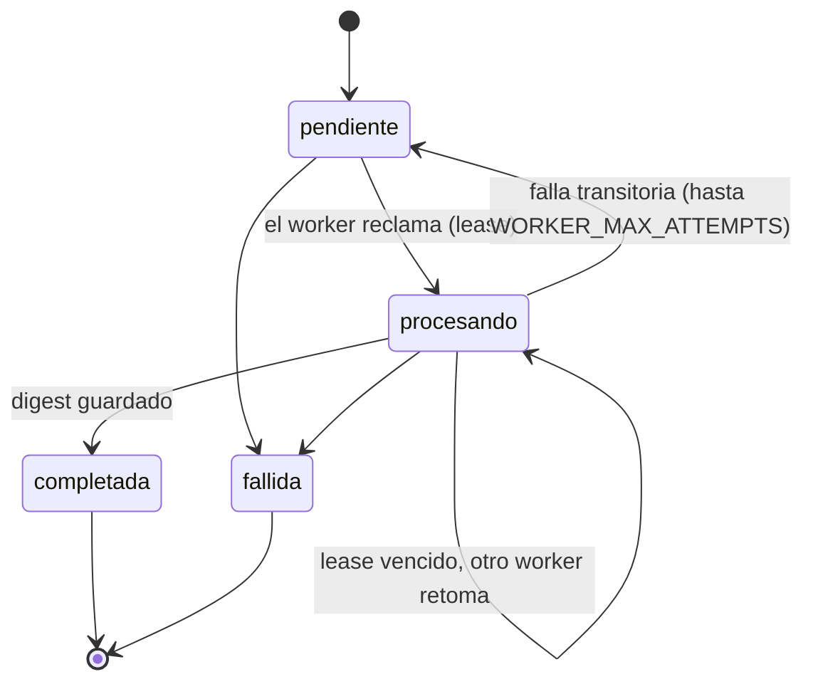

# Referencia técnica

Contrato y comportamiento **vigentes** del servicio, organizados por tema. Para ejecutarlo y probarlo, ver el [README](../README.md); para el contexto del proyecto y las convenciones de trabajo, [CLAUDE.md](../CLAUDE.md); para lo que se verificó y cómo, [VERIFICACION.md](./VERIFICACION.md). Los esquemas JSON de los eventos están en [`eventos/`](./eventos/).

## Contenido

1. [Glosario](#glosario)
2. [Modelo de datos](#modelo-de-datos)
3. [Ciclo de vida de un resumen](#ciclo-de-vida-de-un-resumen)
4. [Ventanas y cobertura](#ventanas-y-cobertura)
5. [API REST](#api-rest)
6. [Cliente del núcleo](#cliente-del-núcleo)
7. [Mensajería con RabbitMQ](#mensajería-con-rabbitmq)
8. [Eventos](#eventos)
9. [Worker y LLM](#worker-y-llm)
10. [Resumen automático](#resumen-automático)
11. [Concurrencia, fallas y límites](#concurrencia-fallas-y-límites)
12. [Hallazgos sobre el código del curso](#hallazgos-sobre-el-código-del-curso)

## Glosario

| Término | Significado en este proyecto |
| --- | --- |
| LLM | Modelo de IA al que se envía una conversación para resumirla (Gemini, o un mock en pruebas). |
| Salida estructurada | El LLM devuelve campos (resumen, decisiones, eventos, tareas) en JSON con un esquema; el texto final lo arma el código. |
| Polling | Consultar el `GET` de un resumen hasta que termine. |
| Snapshot | IDs e intervalo de mensajes fijados para una solicitud; un reintento usa el mismo conjunto. |
| Cobertura | Marca por mensaje de que ya entró a un resumen incremental. |
| Cursor / checkpoint | `(created_at, id)` del último mensaje cubierto por canal; nunca retrocede. |
| Ventana semiabierta | Intervalo `[start, end)`: incluye `start`, excluye `end`. |
| Outbox / inbox | Evento pendiente de publicar / evento recibido y guardado antes de procesarse. Viven dentro del documento del resumen. |
| Lease / ownership | Permiso temporal de un worker sobre una solicitud; si vence, otro la retoma, y el worker vencido no puede confirmar nada. |
| Idempotencia / replay | Repetir una operación o evento sin duplicar su efecto. |
| Dead letter | Mensaje rechazado que pasa a una cola de errores para inspección, sin reintento infinito. |
| Exchange / routing key / cola | RabbitMQ enruta eventos de un exchange a colas según su tipo (routing key). |
| Durable / persistente | Durable conserva el exchange o cola; persistente conserva un mensaje si el broker reinicia. |
| UUID / ObjectId | El UUID (`id`) es el ID público; el ObjectId es el `_id` interno de Mongo y nunca se expone. |
| Proyección local | Copia reconstruible de los mensajes del chat; el núcleo sigue siendo la fuente de verdad. |

## Modelo de datos

Base propia `summaries` (`MONGODB_DATABASE`) en `summaries-mongodb`. Modelos Pydantic v2 congelados, que rechazan campos desconocidos; las fechas exigen zona horaria y se normalizan a UTC con precisión de milisegundos (la de BSON), también en los límites de intervalos.

| Colección / modelo | Campos públicos | Invariantes |
| --- | --- | --- |
| `summaries` / `Summary` | `id`, `channel_id`, `requested_by`, `messageState`, `timeInterval`, `content`, `structured`, `error`, `created_at`, `updated_at` | `content` y `structured` solo en `completada`; `error` solo en `fallida`; `updated_at >= created_at` |
| `digests` / `Digest` | `id`, `summary_id`, `channel_id`, `timeInterval`, `content`, `structured`, `message_count`, `first_message_id`, `last_message_id`, `last_message_at`, `omitted_count`, `created_at` | Resultado inmutable, 1:1 con el resumen, al menos un mensaje; coherente con el snapshot de su solicitud |
| `checkpoints` / `Checkpoint` | `channel_id`, `last_message_id`, `last_message_at`, `last_summary_id` | Uno por canal; el cursor solo avanza |
| `messages` / `LocalMessage` | `id`, `channel_id`, `author_id`, `content`, `created_at` | ID único; contenido de 1 a 4000 caracteres; un replay idéntico no modifica nada y uno distinto es 409 |
| `entries` | `entry_id`, `channel_id`, `user_id`, `status`, `outcome`, `summary_id` | `entry_id` único (ver [Resumen automático](#resumen-automático)) |

`structured` (`StructuredSummary`): `overview`, `decisions[]`, `events[{description, when}]`, `tasks[{description, assignee}]`. `Summary.content` es su `render()`, más una nota si se omitieron mensajes.

**Metadatos internos** (nunca salen por HTTP): en `summaries`, `_request_delivery` y `_terminal_delivery` (evento, `published`, `received`, `attempts`, `last_error`), `_window` (`message_ids`, `omitted_ids`, `timeInterval`), `_lease` (`owner`, `expires_at`), `_attempts`, `_coverage_pending`, `_entry_id` y `_automatic_active`; en `messages`, `_history.covered`.

**Índices** (se crean al arrancar; es idempotente y, ante datos incompatibles, el arranque falla en vez de corregirlos): `summaries` — `id` único; `(channel_id, created_at↓, id↓)`; `(channel_id, messageState, created_at↓, id↓)`; `(messageState, updated_at)`; outbox de solicitudes y de resultados; inbox de solicitudes; `_entry_id` único parcial; `channel_id` único parcial mientras `_automatic_active`. `digests` — `id` y `summary_id` únicos. `checkpoints` — `channel_id` único. `messages` — `id` único; `(channel_id, created_at, id)`; `(channel_id, _history.covered, created_at, id)`. `entries` — `entry_id` único. No hay TTL ni migraciones destructivas.

**Operaciones de `MongoRepository`** (la lógica de aplicación usa estos métodos y no escribe las colecciones directamente):

| Método | Comportamiento |
| --- | --- |
| `create_summary(channel_id, request, event_factory, entry_id)` | Crea `pendiente`; con `event_factory` guarda `summary.requested` en la misma escritura. Con `entry_id`, es automática |
| `create_automatic_summary(...)` | Idempotente por entrada; `already_active` si el canal ya tiene una automática sin terminar |
| `claim_summary(owner, lease)` / `renew_lease` / `release_summary` | Reclamo atómico de `pendiente`, o de `procesando` con lease vencido; cuenta intentos |
| `save_digest(digest)` | Valida contra el snapshot; repetir el mismo resultado devuelve el original, uno distinto es 409 |
| `complete_summary(id, owner)` / `fail_summary(id, error, owner)` | Transición terminal idempotente que escribe el evento terminal en la misma operación; con `owner`, solo el dueño vigente |
| `upsert_message(s)` | Inserción idempotente por ID, individual o en lote (`bulk_write`) |
| `list_messages`, `count_messages`, `list_pending_messages`, `count_recent_pending` | Consultas cronológicas con cursor `after`; `limit` es tamaño de página, nunca un truncamiento |
| `get_window` / `save_window` | Snapshot inmutable: el primer guardado gana |
| `advance_checkpoint(id)` | Solo resúmenes incrementales completados; marca los IDs cubiertos y avanza el cursor si es mayor |
| `pending_*_events`, `mark_*_published`, `record_*_delivery_error` | Outbox de solicitudes y de resultados |
| `list_events(limit, offset)` | Eventos durables ordenados por fecha |
| `receive_channel_entry`, `claim_entry`, `release_entry`, `finish_entry` | Inbox de entradas a canales |

## Ciclo de vida de un resumen

Confirmar dos veces el mismo estado terminal es idempotente; uno distinto es `SummaryStateConflict` (409). Al llegar a un estado terminal se escribe, en la misma operación, su evento (`summary.generated` o `summary.failed`) y se libera la marca de solicitud automática activa.

## Ventanas y cobertura

`SummaryService.build_window(summary_id)` corre en el worker, nunca durante el POST.

1. Valida el canal y **reconcilia siempre** el historial: baja los mensajes por la API de `messages` y los inserta en lote. Una falla de la API se propaga; no se resume con un historial local parcial. Nunca se borra nada local.
2. Selecciona mensajes:
   - **Con `timeInterval`**: todos los del canal en `[start, end)`, estén o no cubiertos.
   - **Sin intervalo (incremental)**: solo los **sin cobertura** con `created_at` anterior al de la solicitud (corte fijo). Incluye los tardíos anteriores al checkpoint.
3. Aplica los **límites del LLM** desde los más recientes (`limit_window`): antigüedad máxima `LLM_MAX_DAYS` (7), `LLM_MAX_MESSAGES` (500) y `LLM_MAX_INPUT_CHARS` (400 000). La antigüedad se cuenta hacia atrás desde `min(fin del intervalo, momento de la solicitud)`: un intervalo que termina en el futuro no corre el límite. Siempre se conserva el mensaje más reciente, salvo que todos superen la antigüedad máxima.
4. Guarda el **snapshot** `_window = {message_ids, omitted_ids, timeInterval}` una sola vez; un reintento rehidrata el mismo conjunto. En incrementales, el intervalo efectivo es `[primer mensaje, momento de la solicitud)`.

**Cobertura.** Al completarse un resumen *incremental*, `advance_checkpoint` marca como cubiertos los IDs del snapshot **y los omitidos por los límites** (si no, el umbral automático se dispararía para siempre por mensajes que nunca se resumirán) y avanza el cursor si es mayor. Un resumen por `timeInterval` no toca la cobertura. Los mensajes que llegan después de fijar el snapshot quedan sin cubrir y entran al siguiente incremental; los resúmenes publicados no se reescriben.

`Checkpoint.messages_since` cuenta los mensajes locales sin cobertura (incluidos tardíos anteriores al cursor); es una vista eventual, no un snapshot atómico. Una ventana vacía no genera digest: el resumen termina `fallida` sin llamar al LLM.

## API REST

Todas las rutas bajo `/api/v1`; OpenAPI en `/docs` y `/openapi.json`. Los errores son siempre `{"detail": ...}` (lista solo en errores de validación de FastAPI).

| Ruta | Comportamiento |
| --- | --- |
| `POST /channels/{id}/summaries` | Valida canal (y usuario, si se indica); guarda la solicitud junto con `summary.requested`; responde **202** + `summary_id` + `Location`. No espera al LLM ni al broker |
| `GET /summaries/{id}` | Solo Mongo (no llama al núcleo): 200 con el estado, o 404 |
| `GET /channels/{id}/summaries` | Valida el canal; lista nuevos primero; `limit` 1–1000 (100), `offset` ≥ 0 |
| `GET /channels/{id}/summaries/latest` | Valida el canal; el último `completada`, o 404 |
| `GET /events` | Eventos durables del servicio (solicitudes y resultados), paginados |
| `GET /health` | Liveness: `{"status": "ok"}` |

| Código | Cuándo |
| --- | --- |
| 404 | Canal o resumen inexistente |
| 409 | Conflicto de estado o de datos persistidos |
| 422 | Usuario inexistente, intervalo inválido (`start >= end`, sin zona), `limit`/`offset` fuera de rango |
| 502 / 503 | Un servicio del núcleo respondió algo inválido / no está disponible; o Mongo no está disponible |
| 500 | Error inesperado: `{"detail": "Internal error"}`, sin detalles internos (el diagnóstico va al log) |

Un canal o usuario inválido no crea solicitud ni evento. Si RabbitMQ está caído, el POST igual responde 202: el evento queda en Mongo y se publica al volver el broker.

## Cliente del núcleo

`CoreClient` (httpx síncrono, un pool compartido durante el lifespan). Contratos observados en el código del curso (sus OpenAPI no declaran esquemas de salida):

| Método | API | Resultado |
| --- | --- | --- |
| `get_channel(id)` | `GET CHANNELS_URL/api/v1/channels/{id}` | `{id, name}` |
| `get_user(id)` | `GET USERS_URL/api/v1/users/{id}` | `{id, display_name}` |
| `list_messages(channel_id)` | `GET MESSAGES_URL/api/v1/channels/{id}/messages` | Lista completa de `{id, channel_id, author_id, content, created_at}` |

`GET .../messages` devuelve `[]` incluso para un canal inexistente: la existencia se valida con `get_channel`.

| Respuesta o falla del núcleo | Error del servicio |
| --- | --- |
| 404 de users | `UserNotFound` → 422 |
| 404 de channels o messages | `ChannelNotFound` → 404 |
| Timeout, error de red o proxy, 429/503/504 | `DependencyUnavailable` → 503 |
| Otro estado, JSON inválido o cuerpo inválido | `DependencyFailed` → 502 |

Se exige HTTP 200 y JSON válido; el ID devuelto debe ser el pedido y cada mensaje debe pertenecer al canal consultado. Los campos extra se ignoran; una lista con un registro inválido se rechaza completa. `CORE_TIMEOUT_SECONDS` (2) aplica a conexión, lectura, escritura y pool. Sin reintentos automáticos, sin redirecciones, sin proxies del entorno, y los mensajes de error no reenvían cuerpos del núcleo. Crear el cliente no contacta al núcleo: su caída no impide arrancar.

## Mensajería con RabbitMQ

Broker propio `summaries-rabbitmq` (volumen `summaries-rabbitmq-data`, hostname estable, sin puertos publicados al host), **el mismo que usa `messages`** mediante `RABBITMQ_URL`.

| Exchange | Tipo / durable | Uso |
| --- | --- | --- |
| `chat` | topic / **no** | El de `messages`; debe declararse igual o RabbitMQ rechaza (`PRECONDITION_FAILED`) |
| `summaries` | topic / sí | `summary.requested`, `summary.generated`, `summary.failed` |
| `gateway` | topic / sí | `chat.channel.entered` (lo publica el Gateway) |
| `summaries.deadletters` | topic / sí | Eventos rechazados |

| Cola propia (durable) | Binding | Confirmación |
| --- | --- | --- |
| `summaries_for_chat_messages_queue` | `chat` / `chat.message.created` | Ack tras guardar el mensaje |
| `summaries_for_summary_requested_queue` | `summaries` / `summary.requested` | Ack tras registrar la recepción en Mongo |
| `summaries_for_channel_entered_queue` | `gateway` / `chat.channel.entered` | Ack tras guardar la entrada |
| `summaries_errors_queue` | `summaries.deadletters` / `#` | Inspección manual |

`EventBroker` usa una conexión `pika.BlockingConnection` en un **hilo propio** (solo ese hilo toca pika) con prefetch 20; no llama al núcleo ni al LLM. Valida el sobre, la routing key, el `subject_id` y los datos; JSON inválido, sujetos incoherentes o el mismo ID con contenido distinto se rechazan sin reencolar y van a *dead letters*. Una falla de Mongo hace `nack` con reencolado y espera; una falla de AMQP reinicia la conexión y la topología sin borrar la outbox.

**Publicación (outbox).** Solicitudes y resultados se guardan en Mongo, dentro del resumen, y el hilo los publica con `delivery_mode=2`, confirmación del broker y `message_id = "{tipo}:{summary_id}"`. Se despierta con `notify()` al crearse la solicitud o terminar el worker; un sondeo de respaldo (`OUTBOX_POLL_SECONDS`, 5 s) y la publicación al reconectar cubren un aviso perdido. Cada intento incrementa `attempts` y un fallo guarda `last_error`. Las solicitudes se publican `mandatory` (tienen cola propia); los resultados **no**: sin suscriptores no se pierden, quedan en Mongo y en `GET /events`. No existe una transacción distribuida Mongo–RabbitMQ: la entrega es *al menos una vez*, y los efectos se deduplican.

## Eventos

Sobre del curso: `{type, subject_id, occurred_at, data}`; la routing key es el `type`. Esquemas JSON Schema en [`eventos/*.schema.json`](./eventos/), generados desde los modelos Pydantic de `app/event_schemas.py` (`python -m app.tools.export_event_schemas`; una prueba falla si se desincronizan).

| Evento | Dirección | `data` |
| --- | --- | --- |
| `summary.requested` | Publica y consume | `channel_id`, `requested_by`, `timeInterval`; en automáticas, también `trigger: "automatic"` y `entry_id` |
| `summary.generated` | Publica | `summary_id`, `channel_id`, `requested_by`, `messageState: "completada"` |
| `summary.failed` | Publica | Lo mismo con `"fallida"` y `error` legible, sin secretos |
| `chat.channel.entered` | Consume | `channel_id`, `user_id`, `entry_id`; `subject_id` = `channel_id` |
| `chat.message.created` | Consume | El mensaje (`LocalMessage`) |

El evento terminal **no incluye el contenido** del resumen: se consulta con `GET /summaries/{id}`. Un consumidor (p. ej. un Gateway) declara su propia cola durable enlazada a `summary.generated`/`summary.failed` y deduplica por tipo + `summary_id`; para ponerse al día, `GET /events`.

## Worker y LLM

**Worker** (`app/worker.py`, hilo propio, independiente del de RabbitMQ). Se despierta por aviso (al recibirse una solicitud o una entrada) y por sondeo de respaldo (`WORKER_POLL_SECONDS`). Por cada solicitud: reclama con lease → arma la ventana → (si no hay digest) llama al LLM y guarda el digest → completa → confirma la cobertura. Renueva el lease antes de cada paso (`WORKER_LEASE_SECONDS` debe superar a `LLM_TIMEOUT_SECONDS`); solo el dueño vigente confirma. Si ya existe el digest de un intento anterior, no vuelve a llamar al LLM. La cobertura incremental se marca como pendiente (`_coverage_pending`) al reclamar y se recupera aunque el proceso caiga tras completar.

| Situación | Resultado |
| --- | --- |
| Ventana vacía, o todo más antiguo que la antigüedad máxima | `fallida`, sin llamar al LLM |
| Canal o usuario inexistente | `fallida` |
| Núcleo no disponible, error `retryable` del LLM | Vuelve a `pendiente` hasta `WORKER_MAX_ATTEMPTS` (3); luego `fallida` con «(tras N intentos)» |
| Rechazo definitivo del proveedor, respuesta que no cumple el esquema tras agotar opciones | `fallida` con el motivo |
| Worker caído a mitad | El lease vence y otro lo retoma |

**Proveedores** (`app/clients/llm_client.py`), detrás de `LLMProvider.generate(LLMRequest) -> StructuredSummary`:

- `mock` (por defecto): resumen determinista y local. `[mock:fail]` en un mensaje simula un fallo definitivo y `[mock:retry]` uno transitorio.
- `gemini`: `POST {LLM_API_URL}/models/{modelo}:generateContent` con la key en la cabecera `x-goog-api-key` (nunca en la URL ni en errores). El prompt va como `systemInstruction`, la transcripción como `[fecha] autor: contenido` y se pide **salida estructurada** (`responseMimeType: application/json` + `responseSchema`), validada con Pydantic; el texto del resumen lo arma el código. Ante 429 reintenta una vez si el proveedor pide esperar ≤ `LLM_RETRY_MAX_WAIT_SECONDS`; si persiste, o ante 5xx, timeout, error de red o una respuesta que no cumple el esquema, prueba `LLM_FALLBACK_MODEL` (las cuotas son por modelo). Credencial rechazada, petición inválida y respuesta bloqueada o truncada son definitivas. Cada intento se registra (modelo, duración, motivo). Un test comprueba que el esquema enviado coincida con el modelo Pydantic.

El prompt prioriza decisiones, eventos y tareas con responsable, y prohíbe inventar datos o convertir días relativos en fechas. Las pruebas automáticas nunca llaman a la API real.

## Resumen automático

1. El Gateway publica `chat.channel.entered` (`gateway`, `data = {channel_id, user_id, entry_id}`). `entry_id` identifica la entrada y **debe conservarse al reintentar**. Un evento incoherente o sin alguno de los campos va a *dead letters* y no se guarda.
2. El consumidor solo **guarda** la entrada (`entries`, única por `entry_id`) y despierta al worker; las llamadas al núcleo las hace el worker, no el hilo de RabbitMQ.
3. El worker valida canal y usuario, reconcilia el historial y cuenta los mensajes **sin cobertura de los últimos `LLM_MAX_DAYS`**. Si son **más de** `MESSAGE_THRESHOLD` (50 no dispara; 51 sí) crea una solicitud normal (`requested_by` = quien entró). Los más antiguos no cuentan: nunca entrarían a un resumen y dispararían la solicitud en cada entrada.
4. **Exclusión e idempotencia:** índices únicos parciales — uno por `_entry_id` (reprocesar tras una caída devuelve la misma solicitud) y uno por canal mientras `_automatic_active` (a lo sumo una automática sin terminar por canal, aunque varios workers evalúen a la vez). La marca se libera al pasar a `completada` o `fallida`. Las solicitudes manuales no participan. Una entrada abandonada en `processing` se reclama al vencer su lease.

`entries.outcome`: `requested`, `below_threshold`, `no_recent_messages`, `already_active`, `invalid_reference` (usuario o canal inexistente), `dependency_unavailable` (núcleo caído tras los intentos máximos) o `error`.

Para probar sin Gateway: `python -m app.tools.publish_channel_entered CHANNEL_ID USER_ID [ENTRY_ID]` (repetir el `ENTRY_ID` simula un reintento).

## Concurrencia, fallas y límites

- El historial soporta entrega al menos una vez. Los cursores ordenan por `(created_at, id)` con comparación estricta; los mensajes que llegan mientras corre el LLM siguen contándose como pendientes.
- Guardar el digest, completar el resumen y avanzar el checkpoint son operaciones separadas (Mongo standalone no ofrece una transacción global aquí): cada una es repetible y el worker recupera lo interrumpido sin repetir la llamada al LLM.
- Un error de PyMongo en una petición responde 503 `Summary storage unavailable`; un fallo de Mongo al arrancar impide servir. Con Mongo caído, `/health` sigue en `ok`.
- Los snapshots y resultados están sujetos al límite de 16 MB por documento de MongoDB. La ventana máxima (500 mensajes) lo mantiene muy por debajo.
- Límites deliberados: sin autenticación (el chat base tampoco la tiene), sin cache del núcleo, sin reintentos HTTP automáticos hacia el núcleo, sin particionar conversaciones largas (el recorte a 500 mensajes/7 días es explícito y queda registrado).

## Hallazgos sobre el código del curso

Verificado leyendo el demo de la Unidad 3 (`microservicios/03_Comunicación/demo`) y los de la 4 (`04_Implementación/demo_04`).

- **El broker es RabbitMQ** (patrón de la Unidad 4, `pika`, cola durable propia por servicio, ack manual). **El compose del demo 3 no lo levanta**, y `messages` solo publica si tiene `RABBITMQ_URL`, que ese compose tampoco define: se aplica con un *override* por stdin (README), sin editar archivos del curso.
- `messages` publica en el exchange `chat` (topic, **no durable**) con routing key = tipo del evento, sin mensajes persistentes. `users` y `channels` no publican al broker. Si el broker cae, `messages` ignora el error (sin outbox): puede haber mensajes sin evento, y por eso se reconcilia por API.
- **Bug del demo:** en `users`, `channels` y `messages`, `insert_one(dict)` agrega `_id` (ObjectId) al diccionario que luego se devuelve y publica. Resultado: **los `POST` de creación responden 500 aunque el dato queda guardado**, y `messages` falla al serializar el evento **antes de publicarlo**: con el demo tal cual, `chat.message.created` nunca se emite. No se modificaron archivos del curso. Para probar hay que tolerar el 500, obtener los IDs de los `GET` y, para ejercitar el camino por eventos, publicar `chat.message.created` a mano en `chat`.
- Contratos: dentro de la red `microsvcs` todos escuchan en el puerto 8000; los IDs son `uuid4` (campo `id`); `GET .../messages` devuelve la lista completa sin paginación, sin filtro por fecha y sin orden garantizado; los errores son `{"detail": ...}`; no hay autenticación.
- El demo de la Unidad 4 trae un *gateway* GraphQL (Ariadne) que agrega servicios REST por HTTP; **no usa el broker** ni publica eventos, y es de otro dominio (players/teams). No existe un Gateway del chat: el servicio solo consume `chat.channel.entered` y publica `summary.generated`/`summary.failed`, que un Gateway futuro podría usar.
- Al bajar el chat con `docker compose -p demo down` desaparece la red `microsvcs` (la crea ese proyecto); los volúmenes se conservan.
- Convenciones del curso que se siguen: Python 3.12-slim, FastAPI, PyMongo, `pika`, `mongo:7` con volumen propio, rutas bajo `/api/v1`, `GET /health`, red externa `microsvcs`.
